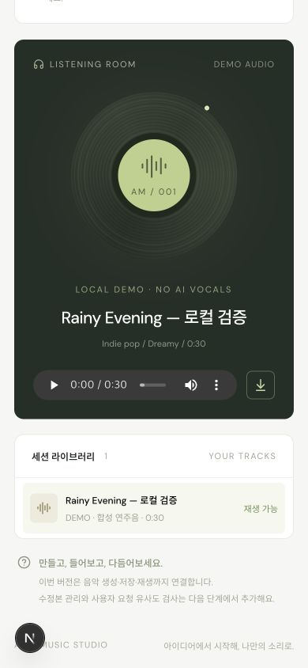
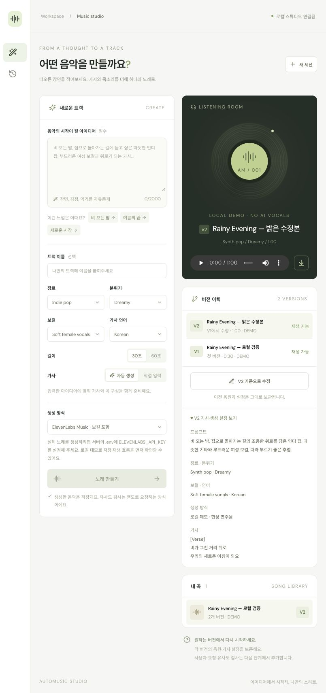

# 구현 현황 — 생성·버전 관리·사용자 요청 유사 구간 검사

기록일: 2026-11-02

현재 사용 범위는 사용자 본인만 사용하는 개인용 도구다. 생성 API 선택은 보류 중이며, 그동안 비교 음원 데이터와 검색 엔진을 준비한다. 회원가입·다중 사용자 격리·구독 결제는 현재 목표에 포함하지 않는다. SQLite와 로컬 음원 저장소를 유지한다.

## 구현 범위

- Next.js/TypeScript의 프롬프트·장르·분위기·보컬·언어·길이·가사 입력 UI.
- FastAPI의 생성 요청 접수, 설정 상태, 이력·개별 상태 조회, 재생·다운로드 API.
- ElevenLabs 공식 `music/plan`과 `music` API 어댑터. 실제 키는 서버에서만 사용.
- 요청과 파일을 영속 저장하는 SQLite + 로컬 음원 저장소. PostgreSQL 연결 설정과 Docker 구성도 포함.
- 별도 DB 폴링 워커. 중복 요청 방지, 상태별 점유 기한, 중단·불확실한 유료 요청의 확인 필요 처리.
- 키 없이 저장 흐름을 확인할 수 있는 명시적인 데모 모드. 합성 연주음이며 AI 노래·보컬·자동 가사가 아님.
- API·워커·웹을 함께 실행하고 종료하는 `npm run dev`.
- 곡별 V1·V2 이력, 원본 버전 관계, 선택한 버전의 설정·가사를 불러오는 수정 모드, 버전별 재생·다운로드.
- 기존 제작 기록을 V1로 연결하는 추가 테이블 기반 업그레이드. 원래 제작 행과 음원은 변경하지 않는다.
- 비교 음원 메타데이터와 불변 특징 revision을 저장하는 `corpus_tracks`, 버전별 작업·결과를 저장하는 `analysis_runs`.
- FMA Small의 정확한 CC BY/CC0 허용 목록 74곡 적재, HTTP Range 부분 다운로드, ZIP 항목 CRC 및 파일 SHA-256 기록.
- contrast chroma 기반 구간 후보 검색과 subsequence DTW 정렬, 사용자가 실행하는 독립 분석 워커, snapshot·알고리즘·입력 hash에 따른 결과 재사용.
- 버전별 검사 버튼·상태·이력·상위 후보와 양쪽 구간 재생·출처 UI.
- 선율·음 길이 실험 방식 선택, 방식별 이력·캐시 분리, 원본·방법 hash별 음표 캐시, 분석 불가·일부 미검토 처리. 기존 chroma 검색과 함께 제공한다.
- 직접 합성한 256쌍의 개발·검증·시험·저음역 스트레스 평가와 개발 집합 한정 임계값 보정. 코드 hash로 보정 자료의 호환성을 확인한다.

## 검증 근거

- 백엔드 테스트 42개 통과, TypeScript 검사와 Next.js production build 통과. 첫 구현에서 Docker Compose 설정 문법 검사도 통과했다.
- 백엔드 테스트: 중복·입력 검증, 키 부재, 실제 형식의 WAV 저장·Range 응답·다운로드, DB 재연결, 워커 중단·중복 유료 호출 방지, 공식 API 요청 형식과 직접 입력 가사 보존.
- 외부 API 요청 형식은 HTTP mock으로 검증했다. 실제 외부 생성 성공이나 가창 품질의 증거가 아니다.
- 브라우저에서 데모 선택 → 예시 프롬프트 입력 → 작업 접수 → ready → 30초 오디오 로딩·재생·다운로드까지 확인했다. 오디오 readyState=4, duration=30, error=null과 재생 currentTime 증가를 확인했다.
- 새로고침 뒤 제작 이력·재생 파일이 유지되는 것을 확인했다.
- 브라우저 경고·오류 로그는 해당 데모 흐름 확인 시 비어 있었다.
- 모바일 폭 390px에서 입력 UI와 결과·재생 화면을 확인했다.
- 버전 관리 브라우저 검증: 기존 V1(Indie pop·30초)에서 가사·장르·길이를 수정해 V2(Synth pop·60초)를 생성했다. V1로 전환했을 때 기존 파일 URL·30초 길이·원래 설정을 확인했고, V2의 직접 입력 가사도 보존됐다. 새로고침 후 같은 곡에 두 버전이 유지됐다.
- 버전 관리 테스트는 동시 4개 수정 요청의 고유 번호와 같은 멱등 키로 동시에 접수한 요청의 단일 버전 생성, 실패 버전 이력, 구 스키마의 원본 행·파일·멱등 키 보존을 확인했다.
- 검색 테스트는 합성 음원 발췌·이조 위치 검출, 요청 전 작업 미생성, 중복·동시 검사 통합, 버전별 결과 분리, 재시작 후 보존, corpus snapshot 고정, 원본·특징 손상 실패 처리, 중단·수동 재시도, 무음·잡음 실패 처리를 확인했다.
- 실제 FMA 74곡 중 5곡을 제외한 69곡 색인으로 통제 실험을 수행했다. 원본 발췌 10/10, +2반음 5/5, 1.15배 템포 5/5에서 원곡 1위. 제외한 5곡은 후보 0건, 백색잡음 1건은 분석 불가 처리. 작곡 유사성·표절 판정 정확도는 아니다. 상세: [검색 엔진 측정](similarity-engine.md).
- 실제 로컬 DB의 60초 데모 버전 → 검사 접수 → 분석 → 결과 저장 → 같은 조건 재사용을 FastAPI TestClient로 확인했다. 74곡 비교의 처리 시간은 약 913ms였고 기존 곡·음원 버전은 보존됐다. 네트워크·브라우저·큐 대기 시간은 포함하지 않은 처리 시간이다.
- 브라우저에서 미검사 V1을 선택해 검사 요청 → 대기 → 74곡 비교 완료(워커 처리 약 1.13초) → 후보 없음 표시 → 새로고침 후 V1 결과 복원 → 동일 조건 결과 재사용을 확인했다. V2의 이전 결과는 별도로 유지됐다. 경고·오류 로그는 없었다.
- 동일한 구간 재생 컴포넌트의 임시 검증 화면에서 실제 저장 WAV는 7초부터 재생돼 약 10.12초에, FMA MP3는 5초부터 재생돼 약 8.14초에 자동 정지했다. 두 음원 모두 readyState=4, error=null이었다. 종료 후 재생하면 구간 시작으로 복귀했다. 임시 화면은 제거했으며 이 검증을 검색 후보가 있는 전체 화면 검증으로 표현하지 않는다.
- 후속 실험 방식의 실제 후보 화면에서 접수·실행·완료, 선율·음 길이 거리, 내 WAV·FMA MP3의 구간 재생과 자동 정지, 새로고침 복원·재사용, 기존 방식 결과 보존을 확인했다. 60초 데모의 첫 74곡 검사는 워커 기준 15.47초였다. 390px 모바일에서 가로 넘침 없이 후보·재생을 확인했고 브라우저 경고·오류 로그는 없었다. 후보의 실제 음악적 유사성에 정답이 있는 검증은 아니다.
- 새 합성 시험 64쌍의 선율 탐지 F1은 1.0000이었다. 낮은 음역 32쌍에서는 오탐 2건·누락 1건이 남았고 음 길이 양성 5건을 놓쳤다. 실제 보컬·법적 판단 정확도로 일반화하지 않는다. [평가·재현·화면](melody-review-experiment.md)

## 아직 검증하지 못한 범위

- 후속 반례 진단에서 기존 chroma 검색의 반주 의존을 확인했다. 새 실험은 합성 자료에서 개선했지만 실제 보컬·다성부의 주선율 정확도는 검증 전이다. 반주·저음 선택, 같은 음높이 재타격, 긴 지속음과 여러 창·곡 검색의 오탐 증가가 남는다. [판례·연구와 개선 조건](plagiarism-criteria-review.md)을 평가 기준으로 유지한다.

- ElevenLabs API 키가 설정되지 않아 실제 노래 생성·가창 품질·실제 비용은 검증하지 않았다.
- Docker daemon이 실행 중이지 않아 Docker 서비스 기동과 PostgreSQL 통합 실행은 검증하지 않았다. native SQLite 실행을 검증했다.
- 현재 로컬 단일 사용자 버전에는 인증·사용자 격리·생성 비용 제한·음원 업로드·파형 직접 편집이 없다.
- 실제 후보가 나온 화면·모바일 연결은 확인했지만, 해당 데모 후보의 작곡상 유사 여부에 대한 정답 평가는 없다. 실제 보컬 음원과 허용된 커버·재연주 자료의 정확도 평가는 남아 있다.
- `needs_review`는 유료 호출의 성공 여부가 불명확한 상태이며 자동 재생성하지 않는다. 외부 제공자와 대조하는 관리 UI는 후속 범위다.

## 다음 구현

1. 허용된 실제 보컬·재연주/커버 쌍으로 추출 정확도와 검색 정확도를 분리 평가. 낮은 음역·같은 반주의 음성 자료·반복 음표와 검색 규모별 오탐을 포함한다.
2. 제공자 선택 후 실제 보컬 노래의 생성·가창·검사 연결 확인. 현재 키·유료 호출 없음.
3. 위 평가에서 드러난 실패를 기준으로 주선율 추출·후보 검색·속도 개선. 현재 합성 집합으로 일반화 성능을 주장하지 않는다.

검증 화면에는 데모임을 표시했다.

