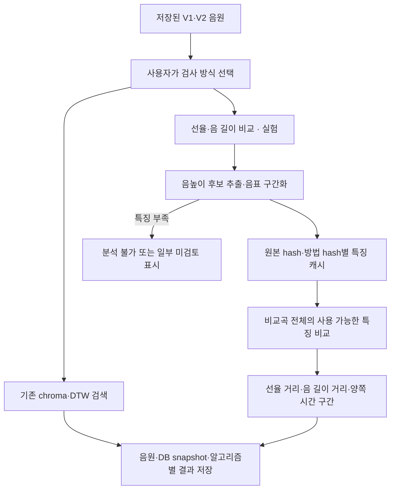
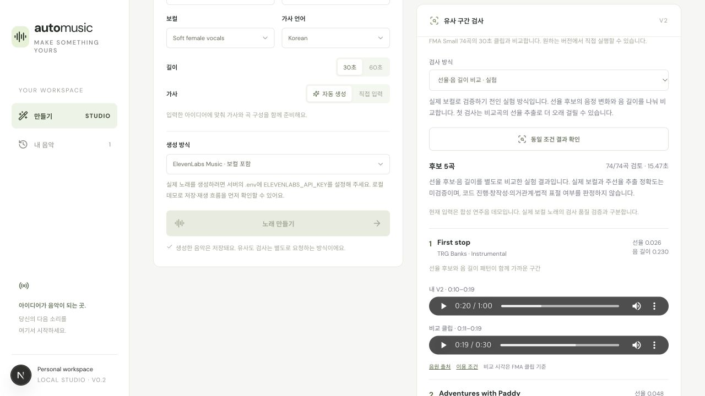

# 선율·음 길이 비교 실험

기록일: 2026-11-02. 기존 chroma 검색에서 발견한 반주 의존 반례를 바탕으로, 평가 집합과 별도의 실험 검사 방식을 추가했다. 실제 보컬 노래의 주선율 추출 정확도와 법적 표절 판정 성능을 입증한 결과는 아니다.

## 구현한 흐름



생성 성공 시 자동 검사하지 않는다. 웹의 `유사 구간 검사 → 검사 방식 → 선율·음 길이 비교 · 실험`을 선택하고 해당 버전의 검사 버튼을 누른다. 기존 검색이 기본값이며 검사 이력과 결과 캐시는 방식별로 분리한다. 분석 실패는 기존 음원을 대상으로 다시 요청하며 음악을 재생성하지 않는다.

추출기는 22,050Hz·FFT 4,096·hop 256에서 고조파 에너지와 시간 중앙값 배경 억제를 사용한다. MIDI 45–89 범위에서 연속적인 음높이 후보를 찾고 짧은 구간을 병합·제외한다. 학습 모델이나 보컬 분리 모델이 아니다. 인접 음정 변화의 subsequence DTW 경로에서 선율 거리와 정규화한 음 길이 거리를 별도로 계산한다. 이조와 일정한 템포 변화의 영향을 줄이는 실험이다. 음 길이는 리듬의 일부이며 박자·강세·타악·스윙을 모두 설명하지 않는다.

런타임은 최대 10초 창을 5초씩 이동하며 chroma 후보 필터 없이 비교곡 전체를 순회한다. 충분한 음표를 얻지 못한 입력은 실패, 일부 비교곡·입력 창을 처리하지 못한 경우는 부분 검토로 기록한다. 이는 “후보 없음”과 다르다. 원본·특징 파일 hash를 확인하고 손상된 파생 음표 캐시는 원본에서 재생성한다.

## 평가 집합과 임계값

직접 합성한 32개 원본 작곡에 각각 8가지 변형을 적용해 **256쌍**을 구성했다. 음색 변경, 반주 변경, +3반음 이조, 1.2배 템포, 같은 반주·다른 멜로디, 음표 순서 변경, 같은 악기의 무관한 곡, 같은 멜로디·다른 음 길이를 포함한다. 개발·검증·시험 간 작곡 seed가 겹치지 않는다. 같은 작곡에서 나온 변형은 독립 표본이 아니며 집합도 작다.

개발 64쌍에서 F1, 정밀도, 더 낮은 임계값 순으로 선택했다. 선율 임계값은 **0.181236**, 음 길이 임계값은 **0.3732495**다. 임계값은 개발 자료에만 맞췄으며 시험 결과를 보고 재조정하지 않았다. `melody.py`의 SHA-256과 보정 파일이 다르면 실행을 거절한다. 최소 음표 수·거리 임계값은 실험 조건이며 법적 마디 수나 표절 기준이 아니다.

v1 비교 경로에서 음 길이가 선율 정렬에 과도하게 영향을 주는 문제를 수정했다. 이미 확인한 seed 1000–1007은 독립 시험으로 재사용하지 않고 회귀 자료로 표시했다. v2의 새 시험은 seed 2000–2007이다. 이전 실험 폴더도 로컬에 보존했다.

| 집합 | 쌍 수 | 기존 검색을 선율 탐지기로 해석한 F1 | 실험 선율 F1 | 실험 선율 오탐 / 누락 |
| --- | ---: | ---: | ---: | ---: |
| 개발 | 64 | 0.9268 | 0.9877 | 1 / 0 |
| 검증 | 32 | 0.9500 | 1.0000 | 0 / 0 |
| 이전 시험의 회귀 확인 | 64 | 0.9744 | 1.0000 | 0 / 0 |
| 새 시험 | 64 | 0.9136 | 1.0000 | 0 / 0 |
| 낮은 음역 스트레스 | 32 | 0.8293 | 0.9268 | 2 / 1 |

새 시험 선율 양성 40쌍·음성 24쌍에서 모두 구별했다. 음 길이 평가는 선율을 유지한 변형만 대상으로 하며, 새 시험 40쌍의 F1은 1.0000이었다. 반면 낮은 음역의 음 길이 평가는 20쌍 중 양성 5건을 놓쳤고 F1은 0.8148이었다. 따라서 통제된 합성 사례의 개선만 주장하며, “표절 탐지 정확도 100%”로 표현하지 않는다. [사례·정답·예측·hash를 포함한 원시 보고서](melody-evaluation-v2.json)

## 실제 앱 연결 검증

- 백엔드 테스트 **42개**, TypeScript 검사, Next.js production build 통과. 실험 방식별 캐시 분리, 잘못된 방식 거절, 보정 hash·유한값 검증, 분석 불가 입력, 일부 미검토, 파생 캐시 손상 복구와 합성 양성 검색을 포함한다.
- 브라우저에서 기존 60초 V2 데모를 선택해 실험 검사 접수 → 대기·실행 → 74/74곡 특징 검토 → 후보 최대 5곡 표시를 확인했다. 첫 특징 추출을 포함한 워커 처리 시간은 **15.47초**, 검색 함수 내부는 14.67초였다. 큐 대기·브라우저 왕복 시간이나 p95 측정은 아니다.
- 실제 후보 화면에서 내 WAV는 약 10.12초부터 재생돼 19.97초에 정지했고, 비교 FMA MP3는 약 11.26초부터 재생돼 19.30초에 정지했다. readyState=4·error=null이었다. 화면의 초 표기는 소수점 이하를 생략한다.
- 방식 전환 시 기존 chroma의 후보 없음 결과가 보존됐다. 새로고침 후 실험 결과가 복원됐고 동일 조건 결과 확인 후 DB 작업 수는 3개로 유지됐다. 생성 버전은 기존 두 개이며 유료 API 호출은 없다. 브라우저 경고·오류 로그는 비어 있었다.
- 이 데모와 FMA 간 후보에는 작곡상 유사성의 정답 라벨이 없다. 후보가 화면에 나왔다는 사실은 검색 품질의 증거가 아니라 연결·표시·재생 검증이다.
- 390px 모바일 폭에서 방식 선택·후보 거리·구간 재생 컨트롤을 확인했다. 문서 너비와 viewport는 모두 390px로 가로 넘침이 없었다. 검증 뒤 임시 화면 크기 설정을 복원하고 개발 서버를 종료했다.



[390px 모바일 검증 화면](assets/melody-review-mobile.jpg)

## 남은 한계와 다음 평가

주선율 대신 반주·저음·고조파를 고를 수 있다. 낮은 음역, 긴 지속음, 같은 음높이의 재타격, 다성부, 실제 가창·발음은 특히 추가 검증이 필요하다. 현재 합성 정답은 생성 시 알고 있는 음표 변경이며, 실제 음원이나 법률상 창작성·의거관계·실질적 유사성의 라벨이 아니다. 법적 검토 항목은 [판례·연구 검토](plagiarism-criteria-review.md)에 따로 정리했다.

쌍별 보정 임계값을 여러 시간 창·74곡의 검색에 적용했다. 반복 비교에 따른 오탐 증가, 짧은 부분 일치의 중요도, 실제 FMA의 주선율 정답은 평가하지 않았다. 실제 보컬·허용된 재연주 쌍·비슷한 반주의 어려운 음성 자료로 **추출 정확도와 검색 정확도를 분리해** 평가해야 한다. 검색 규모가 커지면 이 전수 비교 방식의 속도와 후보 축소에 따른 누락도 새로 측정해야 한다. 현재 FMA 30초 클립 밖이나 DB에 없는 곡은 검토하지 않는다.

## 재현

저장소 루트에서 새 출력 폴더를 지정한다. 원본 WAV·특징·보고서를 생성하며 유료 API나 외부 모델을 호출하지 않는다. 기존 폴더는 덮어쓰지 않는다.

```bash
PYTHONPATH=services/backend .venv/bin/python -m app.evaluate_melody --output-dir data/melody-evaluation-reproduction
PYTHONPATH=services/backend .venv/bin/python -m app.compare_melody --query data/melody-evaluation-reproduction/test/2000/same_melody_new_accompaniment.wav --reference data/melody-evaluation-reproduction/test/2000/corpus/audio/reference.wav
```

배포되는 보정 파일은 `services/backend/app/melody_calibration.json`이다. 평가 보고서의 임계값·방법 hash를 담으므로 무시 경로인 로컬 `data/` 없이도 앱을 시작할 수 있다. 코드 변경 뒤에는 개발 자료에서 다시 보정하고, 이미 열어본 시험을 독립 시험으로 주장하지 않아야 한다.
