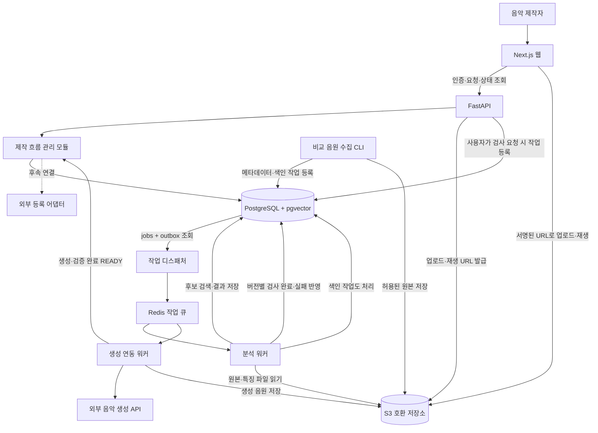
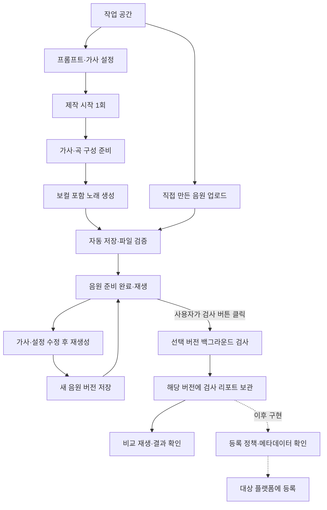
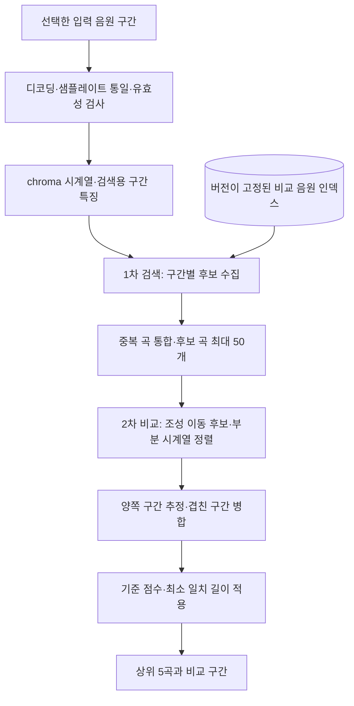
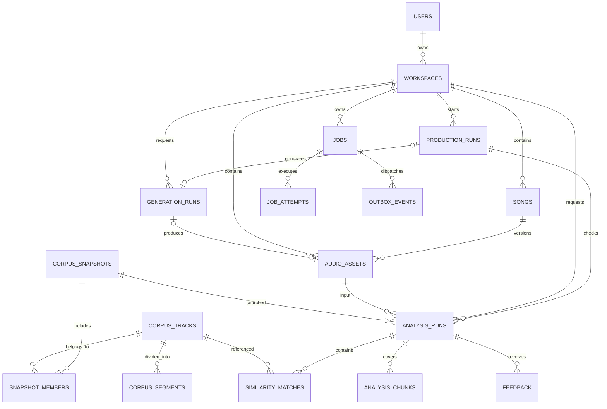
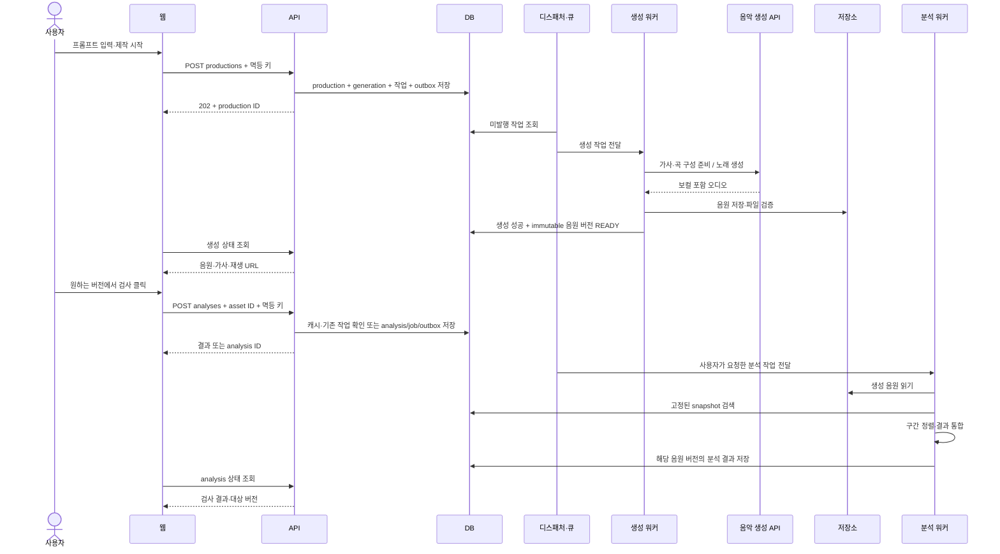
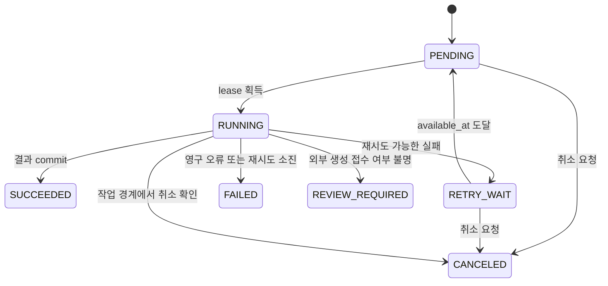

# AI 음악 생성·유사 구간 검색 플랫폼 설계안

작성일: 2026-11-02 · 상태: 구현 전 설계 v0.3

v0.3 반영: 보컬·가사 있는 노래 생성과 유사도 검사를 첫 MVP에 함께 구현하되, 검사는 사용자가 원하는 시점에 요청한다. 생성 완료 직후 재생·수정·재생성이 가능하다. 수정본별 검사와 결과 이력을 지원하며 외부 등록은 후속 단계다.

구현 진행: 생성 API 어댑터, 음원 저장·재생·다운로드, 곡별 버전 관리와 사용자 요청 유사 구간 검색을 구현했다. 현재 목표는 본인만 사용하는 개인용 도구이며 SQLite·로컬 파일·생성/분석 DB 폴링 워커를 사용한다. 버전은 songs·song_versions, 비교곡은 corpus_tracks, 검사 작업·결과는 analysis_runs에 저장한다. FMA Small 74곡과 chroma·DTW 기준 엔진을 검증했다. 실제 보컬 생성과 새 검사 UI의 브라우저 검증은 남아 있다. 본문의 세분화된 목표 데이터 모델, Redis/Celery·S3·pgvector·다중 사용자 구조는 확장 설계다. 현재 범위와 측정은 [README](../README.md), [구현 현황](implementation-status.md), [검색 엔진](similarity-engine.md)을 참조한다.

## 1. 제품의 목적과 첫 사용자

사용자가 프롬프트를 입력하면 보컬·가사 있는 노래를 생성하고 즉시 재생·다운로드·다음 버전 제작을 할 수 있는 웹 서비스다. 유사도 검사는 사용자가 원하는 버전에서 버튼을 눌러 실행하며 음원·가사·생성 정보·버전별 검사 리포트를 보관한다. 최종 목표는 검사 결과와 등록 대상의 정책을 바탕으로 외부 등록을 연결하는 것이다. 직접 만든 음원 업로드는 보조 입력 경로다.

첫 사용자는 개인 작곡가·비트메이커·음악 제작 동아리 구성원으로 가정한다. 초기 목표는 3~5명의 제작자에게 프로토타입을 제공하고, 반복 사용 이유와 검색 결과의 유용성을 확인하는 것이다. 이 수치는 사용자 확보 계획이며 확보된 실적이 아니다.

핵심 사용자 동작은 프롬프트로 제작을 시작하고 결과를 들어본 뒤 수정·재생성 또는 검사를 선택하는 것이다. 서버는 가사·곡 구성 준비, 노래 생성, 파일 검증·저장까지 자동으로 실행한다. 이후 유사도 검사는 별도 요청으로 접수하고 백그라운드에서 수행하며 재생이나 다른 버전 제작을 막지 않는다. 검사 결과는 “이 버전의 어떤 부분을 어떤 곡의 어느 부분과 비교할 것인가?”에 답한다. 법적 판단이나 전체 음원 시장에 대한 안전성을 점수로 표현하지 않는다. 검색 결과가 없으면 “선택한 비교 DB에서 후보를 찾지 못했습니다”라고 표시한다.

프롬프트→음원 준비와 검사 요청→결과 표시의 성공률·시간·비용을 별도로 기록한다. 생성 후 검사 요청률, 수정 횟수, 결과 비교 재생률, 재검사율, 사용자 피드백도 기록한다. 보컬·가사 있는 노래를 우선 지원한다. 가사는 프롬프트에서 자동 생성하거나 사용자가 직접 입력할 수 있다. 첫 버전의 유사도 검사는 오디오를 대상으로 하고 가사 문장 유사도는 별도 기능으로 구분한다. 자동 반복 재생성은 후속 범위이며 도입 시 횟수·비용 상한을 둔다.

## 2. 범위와 완료 기준

| 구분 | 포함 | 완료 기준 |
| --- | --- | --- |
| 생성·검색 기술 검증 | 공식 생성 API 1곳의 보컬·가사 생성, 작은 비교 코퍼스, 구간 검색·평가 | 프롬프트로 실제 음원을 얻고 검색 기준선의 성능·오류 유형 확인 |
| 첫 사용자 MVP | 프롬프트, 가사 자동/직접 입력, 노래 생성, 수정본 이력, 사용자 요청 검사, 생성·검사별 상태, 상위 후보, 재생·다운로드·삭제, 로그인·사용량 제한 | 생성 직후 재생·다음 버전 제작 가능. 원하는 버전에서 검사하고 그 버전에 결과 연결 |
| 보조 입력 | MP3/WAV 업로드, 자동 파일 검증, 검사 | 생성 없이 직접 만든 음원도 동일 엔진으로 검사 |
| 고도화 | 비교 DB 확대, 검색 인덱스 조정, 상세 시각화, HTML 리포트 | 같은 평가 집합과 하드웨어에서 개선 전후 비교 |
| 외부 등록·상용 확장 | 등록 대상별 어댑터, 메타데이터 패키지, 다중 작업 공간, 과금, 외부 API | 대상의 등록 절차·API·필수 정보·이용 조건과 비용 구조 확정 |

첫 MVP는 생성 1회당 노래 1개, 사용자당 활성 생성 1개·활성 검사 1개를 독립적으로 제한하는 안을 사용한다. 따라서 V1 검사 중 V2 생성은 허용한다. 여러 곡을 찍어내는 기능은 같은 제작 실행을 개별 자식 작업으로 묶어 확장할 수 있게 한다. 생성 길이는 제공자가 지원하는 범위에서 초기 30~60초 테스트 프리셋으로 시작하고, 최종 제품 길이는 비용·품질 실험 후 조정한다. 보컬과 가사를 포함하는 실제 노래 생성과 사용자가 실행하는 검사는 모두 첫 MVP 완료 조건이다.

파일 크기·실제 디코딩 길이·PCM 크기에 상한을 둔다. 사용자가 긴 노래의 전체 검사를 요청하면 서버가 최대 60초 작업 단위로 나누고 경계에 겹침을 둬 분석한다. 생성 직후 검사 작업을 자동 생성하지 않는다. 구간별 검사 범위·실패 여부를 보관하고 모든 필수 구간이 완료돼야 전체 검사 완료로 처리한다. 한도 초과·일부 구간 실패를 검사 완료나 후보 없음으로 처리하지 않는다. 직접 업로드도 같은 길이 정책을 적용하며 사용자가 일부 구간만 지정했다면 부분 검사임을 표시한다.

기본 작업 공간은 자동 생성한다. 외부 등록 실행, 공동 편집, 결제, 모바일 앱, 자체 생성 모델 학습, 보컬 분리, 독립적인 멜로디·리듬·화성 정확도 점수, 자동 수정·재생성 루프는 후속 범위다. 내부 음원 저장과 외부 등록은 서로 다른 작업이다.

## 3. 전체 시스템

단일 백엔드 코드베이스에서 모듈을 분리하고 API·워커·디스패처를 각각 실행한다. 초기에는 하나의 호스트에 배치할 수 있지만 프로세스와 자원 한도는 구분한다. 워커 분리는 CPU 작업이 API 응답을 방해하지 않게 하기 위한 선택이다.

`ProductionCoordinator`는 제작 실행의 상태 전이와 생성 과정의 다음 작업 예약을 담당하는 백엔드 모듈이다. 별도 서비스나 장시간 실행 중인 요청으로 만들지 않는다. 생성 결과의 파일 검증·저장까지 자동 처리하고 READY로 끝낸다. 검사 요청은 API가 별도로 접수한다. 생성 작업과 검사 작업 모두 브라우저를 닫아도 계속 진행한다.



실선은 데이터·호출 방향이다. DB를 큐처럼 네트워크 호출하는 것이 아니라 디스패처가 DB의 미발행 이벤트와 복구 대상 작업을 조회한다. 실제 사용자별 데이터 접근은 API에서 소유권을 확인한 뒤 수행한다.

### 기술 선택

| 영역 | 초기 선택 | 선택 이유·후속 판단 |
| --- | --- | --- |
| 웹 | Next.js + TypeScript | 프롬프트·가사 입력, 제작 진행, 결과·이력·재생 UI |
| API | Python + FastAPI | 오디오 처리 코드와 타입·데이터 모델 공유 |
| DB | PostgreSQL + pgvector | 사용자·작업·결과·벡터를 함께 관리. 초기 exact 검색과 이후 ANN 비교 |
| DB 접근·마이그레이션 | SQLAlchemy + Alembic | 제약조건과 데이터 버전 관리 |
| 작업 실행 | Celery + Redis | API 요청 밖에서 실행, 작업 종류별 워커 자원 분리 |
| 오디오 처리 | FFmpeg + librosa | 디코딩·정규화·chroma 기반 기준 알고리즘 |
| 구간 정렬 | chroma 시계열 + subsequence DTW 기준 구현 | 시간 순서를 이용한 후보 구간 비교. 품질 실험 후 교체 |
| 생성 | ElevenLabs Music 공식 API 우선 검증 + 제공자 추상화 | 가사·보컬·곡 구성 지원. 실제 계정 접근·언어 품질·비용 검증 후 채택 |
| 저장소 | S3 호환, 개발에서는 로컬 호환 구현 가능 | API를 거치지 않는 업로드·재생, 원본·파생물 분리 |
| 관측 | 구조화 로그·Prometheus 호환 지표 | 요청/작업 ID, 단계별 시간·실패·비용 기록 |
| 실행 | Docker Compose | 로컬 재현 및 단일 호스트 배포부터 시작 |

FAISS는 처음부터 병행하지 않는다. pgvector의 실제 병목과 품질을 측정한 뒤 같은 데이터·질의로 비교한다. Kafka·Kubernetes·별도 벡터 DB도 도입 조건이 생기면 검토한다.

Essentia는 커버곡 검색 방법을 비교할 수 있는 연구 후보다. 배포 라이브러리·모델로 채택할지는 별도 결정한다. 라이브러리와 모델 가중치의 조건이 같지 않으며 공식 문서 페이지 간에도 모델 라이선스 표기가 달라, 실제 선택한 배포 파일과 메타데이터의 조건을 확인한다. 초기 구현이 Essentia에 의존하도록 고정하지 않는다.

## 4. 사용자 흐름과 화면



| 화면 | 핵심 내용 |
| --- | --- |
| 작업 공간 | 제작 실행 목록, 음원, 생성·분석 이력, 단계별 처리 상태 |
| 새 제작 | 프롬프트, 가사 자동/직접 입력, 언어·보컬·장르·길이 등 지원 조건, 제작 시작 |
| 제작 진행 | 가사·곡 구성 준비→생성→저장→재생 가능. 검사 상태는 따로 표시. 브라우저 재접속 시 복원 |
| 업로드 | 보조 경로. 허용 형식·길이, 진행률, 검증 완료 후 재생·검사 버튼 |
| 결과 | 검사 대상 음원 버전, 입력 구간과 후보 구간, 상위 5곡, 각각 재생, 출처·검색 범위·분석 버전 |
| 음원 상세 | V1/V2 등 버전, 가사·설정 수정 후 재생성, 검사 버튼, 버전별 검사 상태·이력, 보존 기한·삭제 |

결과는 예를 들어 “입력 00:12–00:24 ↔ 후보 A 00:43–00:55”처럼 양쪽 구간을 표시한다. 한 곡에서 여러 일치 구간이 나오면 해당 곡 아래에 묶는다. 초기에는 타임라인 위 구간 표시와 독립 A/B 재생을 제공하고, 템포를 맞춘 동기 재생은 후속 기능으로 둔다.

점수는 알고리즘 내부 정렬 점수 또는 거리로 표기하며 표절 확률·안전도·정확한 백분율로 바꾸지 않는다. 최소 길이와 기준 점수를 넘는 후보만 보여주고, 조건에 못 미치면 5개 미만 또는 0개를 허용한다. chroma 기반 결과를 독립적인 멜로디 검출 결과라고 표시하지 않는다.

## 5. 유사도 검색 엔진

### 두 단계 검색



1. 원본은 보존하고 분석용 mono PCM을 생성한다. 시작 무음을 제거한다면 원본으로 돌아갈 시간 offset을 반드시 저장한다. 초기에는 시간축 변형 전처리를 최소화한다. 특징 hop과 원본 샘플 시각의 매핑도 버전 설정에 남긴다.
2. 후보 검색 단위는 10초 창, 5초 이동을 시작값으로 둔다. 10초보다 짧은 입력은 최소 허용 길이를 확인한 뒤 별도 패딩·마스킹 정책을 적용한다. 정렬에는 pooled vector가 아닌 프레임별 시계열을 사용한다.
3. 첫 실험은 chroma의 시간 구간별 pooling을 기준 특징으로 사용한다. 조성이 다른 질의를 위해 chroma 순환 이동 후보를 실험하고 후보를 합친다. 라이선스가 적절한 학습 임베딩은 동일 평가 세트에서 비교한다. 특징·거리·차원은 실험 결과로 확정한다.
4. 초기에는 작은 데이터의 정확 탐색을 기준선으로 삼는다. 후속 HNSW 인덱스의 후보 재현율을 이 기준선과 비교한다. 모든 창이 같은 곡으로 채워지는 것을 막기 위해 창별 후보를 합친 뒤 곡별 제한을 적용한다.
5. 질의 구간별 검색을 합쳐 후보 곡을 최대 50개 선택하고, 해당 곡의 시계열과 부분 정렬한다. 조성 이동과 템포 차이에 대한 탐색량에 상한을 둔다. 짧은 질의와 긴 후보 전체를 무제한 정렬하지 않도록 검색 위치 주변으로 범위를 제한하되 문맥 여유를 둔다.
6. 정렬 경로에서 입력과 참조의 시작·종료 시간을 추정한다. 경로 길이로 정규화한 비용, 유효 일치 길이, 무음·반복 코드에 대한 예외를 검증 집합에서 평가한다. 점수와 임계값은 알고리즘 버전별로 관리한다.

후보 검색에서 놓친 곡은 정렬 단계에서 복구할 수 없다. 따라서 후보 재현율과 최종 결과 품질을 따로 측정한다. 평균 chroma 같은 기준 특징이 복잡한 음악적 유사성을 충분히 표현한다고 가정하지 않으며, 품질이 낮으면 제품 설명을 좁히거나 검색 특징을 개선한다.

멜로디·리듬·화성을 모두 독립 점수로 보여주려면 각 특성의 추출 방식과 평가 데이터가 추가로 필요하다. MVP는 “chroma 기반 음악적 유사 구간 후보”로 설명하고 편곡·악기 변화에 대한 일반화를 실제 평가로 확인한다.

### 비교 음원 적재와 인덱스 버전

출처/허용 범위 확인 → 메타데이터 등록 → 다운로드·파일 검증 → 분석용 변환 → 특징 추출 → 구간 레코드·벡터 적재 → 샘플 검증 → 새 corpus snapshot 활성화 순서다.

수집 CLI는 데이터 소스별 어댑터를 사용한다. 적재는 `(source, source_track_id, source_revision)`으로 중복을 방지하고 단계별 체크포인트를 남긴다. 실패한 곡만 다시 처리한다. 사용자 작업과 수집 작업은 다른 큐로 보내 사용자 작업이 밀리지 않게 한다.

`corpus_snapshot`은 음원 revision 목록과 feature/index build를 묶은 불변 manifest다. 구축 중인 snapshot은 검색에 노출하지 않는다. 검증이 끝난 새 snapshot을 활성화하고 기존 분석은 접수 시 고정한 snapshot을 계속 사용한다. 권리 철회가 생기면 현재 공개 조회와 재생은 즉시 막으며 과거 snapshot이 권한을 되살리지 않는다.

FMA의 30초 clip은 곡 전체가 아니다. 데이터에 원곡 내 offset이 없다면 결과는 “데이터셋 클립 기준 시각”으로 표시한다. 기준 음원의 시간 범위를 임의로 전체 곡 시각으로 표현하지 않는다.

## 6. 데이터 모델

생성 결과와 업로드 결과 모두 `audio_assets`로 표현한다. 사용자의 음원과 공개 비교 코퍼스는 별도 테이블·접근 경로로 분리한다. 사용자의 업로드는 기본적으로 비교 코퍼스에 편입하지 않는다.

`production_runs`는 사용자의 프롬프트 1회로 시작되는 생성 실행이며 음원 READY까지 관리한다. `songs`는 같은 곡의 여러 수정본을 묶고, 각 `audio_assets`는 덮어쓰지 않는 특정 음원 버전이다. 재생성은 기존 음원을 수정하지 않고 parent_asset_id를 가진 새 버전을 만든다. 검사 기록은 선택한 asset ID에 고정하며 검사 실패는 생성 성공 기록을 지우지 않는다. `analysis_chunks`는 요청한 긴 음원의 분할 분석과 원본 시각 매핑을 보관한다.

MVP의 수정은 가사·프롬프트·조건을 바꾼 재생성 또는 외부 편집본 업로드다. 파형 편집기·트랙별 믹싱·부분 재생성은 별도 후속 기능이다. 메타데이터나 가사 초안만 바꾸고 오디오가 그대로라면 기존 오디오 검사 결과는 유효하다. 실제 오디오가 바뀌면 새 버전은 미검사 상태로 시작한다.



| 테이블 | 중요한 필드·제약 |
| --- | --- |
| `users` | `id`, `oidc_issuer`, `oidc_subject`의 유일 조합 |
| `sessions` | 토큰 hash, 사용자, 만료 시각. 토큰 원문을 저장하지 않음 |
| `workspaces` | `id`, `owner_id`, 이름. MVP는 사용자당 기본 1개 |
| `songs` | workspace, 제목, current_asset_id. 같은 곡의 버전 그룹 |
| `production_runs` | workspace, song_id, parent_asset_id, input_prompt, lyrics_mode, supplied_lyrics, language, desired settings, song_spec/곡 구성, generation status, generation_run_id, 생성 비용 예약·상한, 등록용 메타데이터 초안 |
| `upload_sessions` | 사용자, 생성된 object key, 크기 상한, 만료, 검증 상태 |
| `audio_assets` | workspace, song_id, version_no, parent_asset_id, upload/generated, immutable object revision, content hash, duration, status, generation_run_id(있으면 유일), retention_until. song+version_no 유일 |
| `generation_runs` | workspace, production_run_id, provider/model/version, prompt, composition plan, lyrics, parameters, provider_request_id(가능한 경우), provider 상태, usage. 출력은 audio_assets의 FK로 조회 |
| `analysis_runs` | workspace, optional production_run_id, input_asset_id, query_start/end_ms, corpus_snapshot_id, feature_version, algorithm_version, 설정 hash, status, coverage |
| `analysis_chunks` | analysis_run_id, 원본 start/end/offset, 상태, 오류, 시간 범위. analysis+범위+설정 버전 유일 |
| `jobs` | generation/analysis_chunk/analysis_aggregate/ingestion/upload_validation/production_plan 중 정확히 하나의 대상 FK, status, stage, attempt, available_at, lease_until, lease_token, heartbeat_at, error_code |
| `job_attempts` | job, attempt_no 유일, 시작·종료, worker, 오류, 비용 |
| `outbox_events` | job, dispatch_generation, payload, published_at, available_at. job+generation 유일 |
| `idempotency_requests` | user+operation+key 유일, payload hash, response resource ID. 다른 payload 재사용은 409 |
| `corpus_tracks` | source id/revision, 제목·창작자·출처, license manifest, 저장소 경로, 길이, 시간 기준, 사용 가능 상태 |
| `corpus_segments` | track revision+feature version+start/end 유일, retrieval vector, alignment feature key |
| `corpus_snapshots` | feature/index 버전, manifest hash, 구축·활성 상태, 곡·구간 수 |
| `snapshot_members` | snapshot+track revision 유일. immutable corpus membership |
| `similarity_matches` | analysis, reference revision, 순위, query/ref 시작·종료 ms, 원시 정렬 점수, 점수 버전 |
| `feedback` | analysis, optional match, 사용자, 유용 여부, 설명 |
| `usage_events` | 사용자·작업·provider, 유형, 수량, 단위, 예상/확정 비용, 중복 방지 event key |

음원 자체는 object storage에, 큰 프레임 시계열은 압축된 특징 파일에, 검색용 고정 길이 벡터와 시간 정보는 pgvector에 저장한다. 큰 배열을 작업 큐 메시지에 넣지 않는다.

서로 다른 차원·모델의 벡터는 같은 검색 공간에 혼합하지 않는다. 새 feature version은 별도 테이블/파티션·인덱스 또는 명시적인 build로 구축한다. snapshot을 통해 해당 build만 검색한다. 공개 코퍼스와 사적 음원을 같은 ANN 인덱스에 섞지 않는다.

`similarity_matches`는 analysis+reference+구간+algorithm version으로 중복을 막고 최종 결과는 한 트랜잭션으로 게시한다. 성공 처리에는 현재 lease token이 일치해야 한다. 결과 레코드 생성과 analysis 상태 전환을 같은 트랜잭션에 넣는다.

## 7. API와 요청 흐름

웹과 API를 동일한 사이트의 `/api` 경로로 제공한다. 로그인은 OIDC 제공자 한 곳과 서버 측 세션을 사용한다. 브라우저에는 Secure·HttpOnly 쿠키를 쓰고 변경 요청에는 CSRF 방어를 적용한다. 어떤 제공자를 쓸지는 실제 배포 환경에서 선정한다.

| 메서드·경로 | 역할 |
| --- | --- |
| `GET /api/v1/me` | 사용자·기본 작업 공간 |
| `POST /api/v1/productions` | 프롬프트·가사 모드·조건으로 생성 접수, `202`. 재생성 시 song_id·parent_asset_id 지정. 자동 검사 없음 |
| `GET /api/v1/productions/{id}` | 생성 단계와 생성 음원·가사·비용 조회 |
| `GET /api/v1/songs/{id}/versions` | 음원 버전별 생성 정보·검사 상태·이력 |
| `POST /api/v1/uploads` | 업로드 세션·서명 URL 발급 |
| `POST /api/v1/uploads/{id}/complete` | object 존재·크기·revision 확인, 검증 작업 접수. 검증 성공 시 READY, 자동 분석 없음 |
| `GET /api/v1/assets` | 사용자 음원·검증 상태, 커서 페이지네이션 |
| `GET /api/v1/assets/{id}/playback` | 소유권 확인 후 단기 재생 URL |
| `DELETE /api/v1/assets/{id}` | 즉시 접근 차단·활성 작업 취소 요청·파생물 삭제 예약 |
| `POST /api/v1/analyses` | 사용자가 선택한 immutable asset ID·구간 검사. 재사용 가능한 결과는 `200`, 기존 진행 작업 연결 또는 신규 작업 접수는 `202` |
| `POST /api/v1/analyses/{id}/retry` | 동일 음원에서 실패한 검사만 재실행. 기존 음원·생성 결과 보존 |
| `GET /api/v1/analyses/{id}` | 상태·단계·실패 이유 |
| `GET /api/v1/analyses/{id}/matches` | 후보·양쪽 구간·출처·검색 범위 |
| `POST /api/v1/generations` | 선택적 하위 API. 일반 사용자 화면은 productions로 생성하고 analyses로 검사 요청 |
| `GET /api/v1/generations/{id}` | 외부 상태·생성 결과 |
| `GET /api/v1/jobs/{id}` | 권한 범위 내 공통 작업 상태 |
| `POST /api/v1/jobs/{id}/cancel` | 협조적 취소. 외부 생성 중단 가능 여부는 제공자에 따름 |
| `POST /api/v1/analyses/{id}/feedback` | 사용자가 결과 유용성 평가 |

제작·생성·분석·업로드 완료 요청에 `Idempotency-Key`를 받는다. 같은 사용자·동작·키와 동일 payload는 같은 resource ID를 반환한다. 다른 payload라면 409를 반환한다. 사용자 요청 키와 내부 분석 캐시는 서로 다른 개념이다.

생성 결과 READY 전환 시 analysis/chunk/job/outbox는 만들지 않는다. 사용자가 검사 요청을 보냈을 때만 해당 asset revision과 corpus snapshot·feature/algorithm/config version을 고정해 analysis/chunk/job/outbox를 한 트랜잭션으로 저장한다. 사용자 범위의 동일 검사 키에 유일 제약을 두거나 원자적으로 점유해 더블 클릭·동시 요청을 하나의 활성 검사로 합친다. 생성과 검사는 자원·사용량을 각각 예약하며, 검사 요청이 생성 성공을 위한 선행 조건이 되지 않는다.

분석 캐시 키에는 asset revision, query 범위, corpus snapshot, feature/algorithm/config version을 모두 포함한다. 초기에는 사용자 범위에서만 재사용한다. 음원이 삭제됐거나 권한이 바뀌면 캐시를 통해 결과가 다시 노출되지 않게 한다.

같은 음원·범위·설정·코퍼스의 완료 결과가 있으면 재계산 없이 반환한다. 검사 진행 중이면 기존 analysis ID를 반환한다. 같은 사용자 안에서 파일이 동일한 경우도 검증된 content hash로 재사용할 수 있다. corpus/알고리즘 버전이 달라지면 기존 결과를 새 검사로 위장하지 않고 이전 검사 조건을 표시한다. 활성 검사 키의 점유는 terminal 상태에서 해제할 수 있어 실패 복구와 명시적인 재실행을 막지 않는다.



서명 URL로 업로드한 object는 완료 후 덮어쓰기로 검증 내용을 바꾸지 못하게 한다. 버전 ID를 고정하거나, 검증용 임시 object를 서버 전용 immutable key로 복사한 뒤 사용한다. 검증 단계에서 실제 디코딩 길이를 확인해야 READY가 된다.

## 8. 작업 상태·실패 복구

상태와 실행 단계는 분리한다. 상태는 `PENDING`, `RUNNING`, `RETRY_WAIT`, `SUCCEEDED`, `FAILED`, `CANCELED`, `REVIEW_REQUIRED`를 사용한다. 단계는 decode/features/retrieve/align/persist 또는 provider_submit/provider_wait/download로 기록한다. 근거 없는 실시간 진행률 대신 현재 단계를 우선 표시한다.

위 상태는 개별 job의 실행 상태다. 생성은 `QUEUED → PLANNING → GENERATING → VALIDATING → READY`로 끝낸다. 검사는 음원 버전별로 `NOT_REQUESTED → QUEUED → RUNNING → SUCCEEDED/FAILED/CANCELED`를 별도로 표시한다. 검사 완료 결과의 검토 상태는 처리 상태와 분리한다. 검사 성공은 설정한 범위의 처리 완료이며 등록 허가나 권리 확인 완료를 의미하지 않는다.

예를 들어 V1 검사 중 V2를 생성하면 V1 작업은 계속 V1에 결과를 저장한다. V2는 미검사 상태로 표시하고 V1의 완료 결과가 V2의 검사 완료 배지를 켜지 않게 한다. 필요하면 사용자가 V1 검사를 취소할 수 있다. 구버전 검사 결과는 그 버전을 선택하면 열람할 수 있다.



| 실패 상황 | 처리 |
| --- | --- |
| DB 저장 성공 후 큐 발행 실패 | 같은 트랜잭션에 남긴 outbox를 디스패처가 재발행 |
| 발행 성공 후 published 표시 실패 | 중복 발행 허용. worker lease와 terminal 상태 확인으로 중복 결과 차단 |
| 워커 종료·정체 | heartbeat/lease 만료를 reconciler가 확인하고 새 dispatch generation으로 재접수 |
| 오래된 워커가 뒤늦게 결과 저장 | lease token 조건부 갱신으로 commit 차단 |
| 큐 내용 유실·재전달 실패 | DB의 미완료 작업을 복구 기준으로 사용. DB+큐에 대한 모니터링·백업 필요 |
| 일시적인 저장소·네트워크 오류 | 제한된 지수 backoff+jitter. 예: 최대 3회, 긴 대기는 available_at으로 관리 |
| 깨진 파일·지원하지 않는 형식 | 영구 오류. 같은 입력을 무한 재시도하지 않음 |
| 무음·너무 짧은 입력 | 명시적인 입력 오류 또는 분석 불가 결과 |
| 후보 없음 | 정상 완료, matches=[] |
| 생성 성공 후 검사 실패 | 생성 음원·가사 보존. 생성 API 재호출 없이 실패 구간 검사만 재실행 |
| 긴 음원의 일부 구간 실패 | 전체 검사 미완료 표시. 성공 구간은 재사용하고 실패 구간만 복구 |
| 생성 완료 이벤트 중복 | 동일 생성 결과·asset revision의 중복 저장 차단. 자동 검사 작업은 만들지 않음 |
| 검사 중 새 버전 생성 | 기존 검사는 원래 버전에 완료. 새 버전은 미검사, 재생·추가 생성 가능 |
| 같은 검사 반복 클릭 | 동일 검사 키의 완료 결과 재사용 또는 진행 작업 연결 |
| 외부 생성 요청 후 응답 유실 | provider의 멱등 키/요청 조회로 접수 여부 확인. 불가능하면 REVIEW_REQUIRED, 자동 재생성 금지 |
| 웹 닫기·새로고침 | 작업은 계속 수행, 같은 resource ID로 상태 재조회 |
| 사용자 음원 삭제 | 접근 즉시 차단, tombstone 확인, 진행 중 결과 commit 금지, 파일·특징·캐시 삭제 |

DB가 작업 상태의 기준이다. 큐는 작업을 깨우는 역할을 맡는다. 큐가 작업을 정확히 한 번 실행한다고 가정하지 않는다. 분석은 재실행 가능하게 만들고, 생성처럼 비용이 발생하는 외부 동작은 별도 provider 요청 기록으로 보호한다.

Celery의 late acknowledgement만으로 모든 워커 손실이 자동 복구되는 것은 아니다. `acks_late`, worker-lost 처리, Redis visibility timeout을 hard runtime/heartbeat와 함께 검증한다. hard runtime은 visibility timeout보다 짧게 둔다. 비동기 제공자의 대기는 provider ID를 저장한 짧은 조회 작업으로 분리한다. 동기·스트림 제공자는 제한된 실행 시간 안에서 오디오를 수신하고, 요청 성공 여부를 알 수 없으면 자동 재제출하지 않는다. terminal 상태는 자동으로 뒤집지 않고 수동 재실행은 새 run을 만든다.

## 9. 생성 제공자 연동

첫 구현 후보는 ElevenLabs Music 공식 API다. 공식 문서에서 자연어 프롬프트의 보컬 포함 음악 생성과 가사·스타일·길이를 포함한 composition plan을 확인했다. prompt에서 plan을 만든 다음 오디오를 생성하거나 사용자가 입력한 가사로 plan을 구성한다. 언어별 실제 가창 품질과 계정별 접근·비용은 아직 실험하지 않았다. 제공자를 확정하기 전 짧은 보컬 샘플로 검증한다.

프롬프트 입력만으로 끝나는 자동 모드에서는 음악 제공자의 가사·구성 생성 기능을 먼저 사용한다. 별도 LLM은 필요할 때 `SongSpecBuilder`에 추가할 수 있지만 첫 버전의 필수 의존성으로 늘리지 않는다. 직접 입력 가사 모드도 제공한다. 생성된 제목·가사·언어·스타일·구조·모델·설정을 음원과 함께 보관한다.

`GenerationProvider` 인터페이스는 `capabilities`, `build_plan`, `generate`, 선택적인 `get_status`·`fetch_output`·`cancel`을 제공한다. `generate`는 즉시 오디오/오디오 스트림 또는 외부 pending request를 반환할 수 있다. 제공자마다 없는 비동기 상태 API를 있다고 가정하지 않는다. 스트림 방식은 워커가 제한된 임시 저장소에 수신한 뒤 검증·저장한다. 프롬프트·장르·길이·템포 등은 제공자가 지원하는 값만 UI에 노출한다. 제공자에 전달한 정규화된 설정과 실제 모델 revision을 기록한다.

외부 제공자는 공식 API, 결과 저장·다운로드 가능 여부, 서비스 제공 조건, 생성 음원 사용 조건, 비용, 멱등성·상태 조회 기능, 최대 대기 시간으로 비교한다. 비공식 웹 자동화 API를 제품의 필수 의존성으로 삼지 않는다.

제공자에서 받은 음원도 업로드 음원과 같은 디코딩·길이·형식 검증 모듈을 통과해야 READY가 된다. 생성 성공과 분석 가능 상태를 구분하고, 검사 요청은 READY 음원에만 허용한다.

비동기 제공자는 polling 기반으로 구현하고 webhook은 제공자가 지원할 때 추가한다. 동기/스트림 제공자는 워커에서 실행하고 사용자 웹은 자체 production 상태를 조회한다. webhook을 쓰면 서명·만료·event ID 중복을 검증하고 서버에서 결과를 재확인한다. 미확인 provider ID를 다른 사용자의 generation에 결합하지 않는다.

비용 제한은 UI 안내가 아니라 서버에서 원자적으로 예약한다. 사용자별 일일 생성 횟수, 동시 생성 수, 전체 비용 상한을 두고 접수·완료·실패·확인 대기별 예약 해제 정책을 구분한다. 비용·제공자 접수 여부를 확인하지 못한 작업을 즉시 재허용해서 상한을 우회하지 않게 한다.

### 이후 외부 등록 연결

등록 대상은 아직 미정이다. 서비스 내부 목록 저장, 음원 유통 플랫폼 제출, 공개 게시, 저작권 관련 등록은 다른 절차이므로 `PublicationProvider`의 실제 구현은 대상 확정 후 설계한다. 첫 MVP에서는 외부 등록을 실행하지 않는다.

등록 모듈에는 audio revision, 제목·가사·언어·창작/생성 정보, 분석 결과·검색 범위·버전, 해당 대상에 필요한 metadata를 넘긴다. 장래 `등록할 버전 선택 → 그 버전의 검사·등록 정책 확인 → 등록 대기 → 제출 → 결과 확인`을 연결한다. 등록 정책이 검사를 요구하는 경우 선택 버전이 미검사이면 검사 필요 상태를 안내하거나 명시적인 등록 워크플로우 안에서 검사를 실행한다. 실제 등록 여부는 목적지의 조건과 등록 정책으로 정하고 유사 후보 없음만으로 자동 등록 가능하다고 간주하지 않는다. 등록 실패 시 노래를 다시 만들지 않고 제출 단계만 복구한다.

## 10. 데이터 사용과 파일 접근 정책

비교 코퍼스는 연구용/공개 서비스용/상용 서비스용을 같은 것으로 취급하지 않는다. `license_manifest`에 출처, 확인 날짜, 라이선스 URL·버전, 출처 표기, 검색 처리·재생·다운로드 허용 여부의 검토 결과를 기록한다. 공개 배포 snapshot에는 해당 배포 범위에서 사용할 수 있는 항목만 포함한다. 처리 허용과 미리듣기 허용은 별도 필드다.

FMA는 코드·메타데이터·음원의 조건이 다르며 저장소도 음원은 아티스트가 선택한 라이선스로 배포한다고 설명한다. 오디오 파일을 다운로드할 수 있다는 사실만으로 상용 제공·재배포 범위를 정하지 않는다. 검색 처리 자체가 가능한지도 대상 이용 방식에 맞춰 확인한다.

사용자 음원은 private object로 저장하고 기본 30일 보존을 제안한다. 실제 배포 전 제품 정책으로 확정한다. 사용자 음원을 다른 사람의 검색 DB나 모델 학습에 자동 사용하지 않는다. 생성 시 프롬프트를 외부 제공자에게 전달한다는 점을 해당 화면에 표시한다. 직접 업로드한 음원은 유사도 분석 때문에 생성 제공자에게 전달하지 않는다.

파일 입력은 확장자만 검사하지 않는다. 실제 코덱·디코딩 길이·예상 PCM 크기를 검증한다. FFmpeg 프로세스는 네트워크 없이 제한된 임시 디렉터리, CPU·메모리·실행 시간 안에서 동작하게 한다. 외부 제공자 결과 다운로드는 허용된 호스트와 크기로 제한한다.

다운로드·재생 URL은 짧은 만료를 사용하며 발급 때마다 소유권·재생 허용 상태를 확인한다. 삭제 직후 이미 발급된 서명 URL은 만료 전까지 유효할 수 있으므로 TTL을 짧게 하고, 즉시 철회가 필수인 기능은 인증 프록시 등 별도 구조로 전환한다. 로그에 서명 URL, 세션 토큰, API 키, 원문 음원을 기록하지 않는다.

## 11. 평가·성능 실험

### 품질 평가

| 평가 집합 | 목적 | 지표 |
| --- | --- | --- |
| 원본 일부 추출 | 알려진 음원의 구간 복원 | 후보 Recall@K, 시작·종료 오차 |
| 음량·인코딩·템포·조성 변형 | 변형 내성 분리 평가 | 변형 종류·강도별 recall·오차 |
| 직접 연주/재편곡한 허가된 쌍 | 음악적 구성 유사성 평가 | 검토자가 표시한 구간과 overlap, Precision@K |
| 같은 장르·다른 곡 | 분위기만 비슷한 오탐 관찰 | 임계값 이상 오탐률 |
| DB에 대응곡이 없는 입력 | 무관한 결과 거절 | false-positive rate, 후보 없음 정확성 |

원본 변형은 같은 녹음을 기반으로 하므로 커버곡·재작곡 유사성의 대체 증거로 쓰지 않는다. 데이터가 부족하면 해당 범위는 검증하지 못했다고 명시한다. 모델·임계값 조정용 데이터와 최종 평가 데이터를 곡·작곡 기준으로 분리하고, 같은 원곡의 변형이 양쪽으로 새지 않도록 한다.

초기 평가 세트는 기준 곡 30~50개에서 여러 변형을 만들고, 사용 가능한 직접 연주 쌍과 어려운 음향적 유사/음악적 비유사 샘플을 추가한다. 작은 초기 집합의 점수를 일반 시장 정확도로 표시하지 않는다. 후보 recall은 정답이 1차 후보에 포함되는 비율, ANN recall은 exact 검색 후보에 대한 근사 인덱스의 보존율로 구분한다.

### 처리량·지연·운영 지표

- API: 업로드 전송·제공자 대기와 분리한 접수/상태 조회 p50/p95, 4xx/5xx, DB query 시간.
- 분석: 큐 대기, 디코딩, 특징 추출, 후보 검색, 정렬, 저장 시간 각각의 p50/p95.
- 리소스: worker CPU·peak RSS·임시 디스크, 인덱스 크기·build 시간·검색 recall.
- 복구: 워커 종료·큐 재시작 시 누락/중복 결과 수, 복구 시간, 장기 RUNNING 수.
- 비용: 분석 1건당 CPU 시간·전송량·저장량, 생성 1건당 실제 비용·미확정 비용.
- 제품: 프롬프트→음원 준비 성공률·시간, 생성 후 검사 요청률, 검사 요청→결과 시간, 결과 열람률, A/B 재생률, 후보 유용성 평가, 재사용률. 가창 품질·가사 반영도는 검색 품질과 별도로 평가.

초기 목표는 접수·상태 API p95 500ms 이내를 가설로 둔다. 분석 완료 시간은 첫 기준 측정 뒤 정하며, 30초·60초 입력별로 하드웨어/worker 수/동시 요청/corpus 크기/캐시 상태를 함께 공개한다. 외부 생성 시간은 별도 보고한다. 목표를 실제 측정값으로 쓰지 않는다.

부하 검증은 단일 작업 → 동시 5개 → 동시 20개 접수 순으로 늘린다. 큐 대기가 길어져도 API 응답과 결과 정합성이 유지되는지 본다. 큐 상한·사용자별 제한으로 입장을 제어하고 초과 요청은 429와 재시도 안내를 반환한다. 필요 이상의 워커 동시 실행으로 CPU와 메모리를 소진하지 않게 한다.

### 반복 수정과 검사 응답성

아직 엔진을 구현·벤치마크하지 않았으므로 실제 검사 시간을 초 단위로 확정하지 않는다. 입력 길이, 특징 추출 비용, 후보 수와 정렬 범위, 코퍼스 크기, CPU/GPU, 큐 대기에 따라 달라진다. 벡터 후보 검색이 빨라도 전체 분석이 같은 시간에 끝난다고 가정하지 않는다.

첫 MVP는 사용자 요청 검사 + 비동기 실행 + 버전별 결과 + 동일 검사 재사용으로 구현한다. 생성 직후에는 파일 검증과 재생 준비만 수행하며 무거운 특징 추출·검색은 검사 요청에 맞춰 수행한다. 결과 대기 중에도 노래 재생·다운로드·다른 버전 생성이 가능하다.

성능 실험은 30초·60초 입력, 지원 시 긴 곡, 최초 검사·같은 검사 재조회·새 버전 검사, 큐 대기를 포함/제외한 시간으로 구분한다. 빠른 후보 미리보기와 정밀 결과를 분리하는 UI는 기준 측정 뒤 필요하면 추가하며 후보 미리보기를 전체 검사 완료로 표시하지 않는다.

오디오 특징 캐시는 음원 내용·전처리·특징 버전으로, 검색·정렬 결과 캐시는 비교 코퍼스와 알고리즘까지 포함해 분리한다. 코퍼스만 바뀌면 입력 특징을 재사용할 수 있다. 실제 음원이 바뀌면 전체 재검사를 기본으로 하며, 같은 프롬프트나 변경한 가사 범위를 근거로 오디오 일부가 동일하다고 가정하지 않는다.

부분 검사에서는 사용자가 선택한 실제 음원 구간을 대상으로 검색하고 부분 결과임을 표시한다. 바뀌지 않은 부분을 재사용하는 증분 검사는 정확히 일치하는 PCM 구간·문맥/경계·시간 offset을 검증할 수 있을 때만 후속 도입한다. 새로 생성한 노래는 대체로 기존 오디오와 동일하다고 보장할 수 없으므로 원칙적으로 새 입력으로 취급한다.

## 12. 규모 산정과 확장 조건

10초 창·5초 이동 가정에서 30초 clip은 5개, 180초 음원은 35개 구간을 만든다. 아래는 스키마·벡터 차원이 확정되기 전의 계산 예시다.

| 코퍼스 가정 | 검색 구간 수 | 512차원 float32 원시 벡터만의 크기 |
| --- | --- | --- |
| 8,000곡 × 30초 | 40,000 | 약 81.9MB |
| 100,000곡 × 180초 | 3,500,000 | 약 7.17GB |

위 값은 decimal 단위이고, index·row·메타데이터·원음·프레임 특징·복제·백업 공간이 모두 제외돼 있다. 모델 차원·창 길이가 바뀌면 다시 계산한다. 데이터 규모와 동시 사용자 수는 다른 축으로 실험한다.

| 실제로 관측한 병목 | 다음 조치 |
| --- | --- |
| 사용자 분석이 색인 적재에 밀림 | ingestion worker 동시성 축소·별도 호스트 |
| CPU 정렬이 지연 대부분 차지 | 후보 수/정렬 범위·특징 프레임 조정, 품질 손실 함께 평가 |
| exact 검색이 지연 대부분 차지 | HNSW 등 ANN, exact 대비 recall·메모리 비교 |
| DB 검색이 사용자 메타데이터 API에 영향 | 검색 workload 별도 인스턴스·서비스 검토 |
| 메모리에 비해 인덱스가 커짐 | 차원·정밀도·구간 수 조정, 별도 검색 엔진과 동일 조건 비교 |
| 외부 생성 지연 증가 | provider 대기와 내부 지연 분리, 동시성·제한·상태 조회 정책 조정 |

FAISS나 다른 벡터 엔진으로 이동할 때 `CandidateRetriever` 인터페이스를 유지하고 feature version·snapshot·거리 함수·평가 질의를 동일하게 맞춘다. 엔진 교체가 알고리즘 품질 개선을 뜻하지는 않는다.

## 13. 배포·저장소 구조

로컬은 `web`, `api`, `analysis-worker`, `generation-worker`, `dispatcher`, `postgres`, `redis`, `object-storage`를 Compose로 실행한다. 첫 배포는 동일 이미지에서 역할별 실행 명령을 나누고 단일 호스트로 시작할 수 있다. API·DB·워커 자원 제한과 DB 백업·복구를 설정한다. 이 단계는 고가용성 구성이 아니며 호스트 장애 시 전체 서비스가 중단될 수 있다.

DB는 상태와 결과, 저장소는 음원·특징의 원본이다. Redis 지속성 설정만으로 복구를 보장하지 않으며 DB outbox·작업 재조정 경로를 함께 검증한다. 큐·DB·저장소는 인터넷에 직접 공개하지 않는다. GPU는 모델 검증 후 필요할 때 추가한다.

```text
apps/
  web/                    # 업로드·생성·결과·이력 UI
services/
  backend/
    app/api/              # 인증·입출력·소유권 확인
    app/domain/           # productions, assets, analyses, generations, usage
    app/production/       # 생성 단계 전이·버전 관리·향후 등록 연결
    app/audio/            # decode, features, retrieval, alignment
    app/providers/        # generation provider adapters
    app/tasks/            # Celery 작업, lease, retries
    app/dispatch/         # outbox 발행·복구
    app/db/               # 모델·repository
    migrations/
tools/
  corpus/                 # 수집·적재·snapshot·권리 manifest
  benchmarks/             # 고정 평가·지연·복구 실험
infra/
  compose.yaml
  monitoring/
docs/
  music-platform-design.md
  decisions/              # 기술 결정 근거
```

하나의 백엔드 코드를 API·워커에서 재사용한다. 각 프로세스가 서로 다른 DB 스키마를 소유하는 마이크로서비스 구조는 초기 범위에 넣지 않는다.

## 14. 구현 마일스톤

기간은 주당 투자 시간과 오디오 처리 경험에 따라 달라진다. 주차보다 아래 통과 조건을 기준으로 진행한다.

| 단계 | 산출물 | 다음 단계로 가는 조건 |
| --- | --- | --- |
| M0 생성·검색 검증 | 공식 API로 가사·보컬 포함 실제 음원 생성, 작은 코퍼스 검색·고정 평가 | 음악 생성 접근·품질·비용과 검색의 유용성·오류 확인. 생성과 검색 둘 다 검증 |
| M1 생성·요청 검사 기반 | production·song·asset version·analysis 모델, 저장소, job/outbox/worker | 프롬프트로 생성·보관 후 즉시 재생. 별도 검사 요청과 검사만 복구 가능 |
| M2 첫 사용자 MVP | 프롬프트·가사 모드·버전 이력·검사 버튼·상태·Top N·재생·다운로드·삭제·인증·사용량 제한 | 제작자 3~5명에게 생성·수정·선택 검사 제공. 검사 중 편집·새 생성과 결과 버전 정합성 검증 |
| M3 운영·개선 | 공개 가능한 배포, corpus 확대, 지원 곡 길이·처리량 확대, 대시보드·벤치마크 | 품질·지연·복구 개선을 재현 가능한 수치로 설명 |
| M4 외부 등록 확장 | 확정한 대상의 metadata·등록 어댑터·정책·이력 | 등록할 음원 버전과 검사 결과의 일치, 제출 실패 복구 |

생성과 검사를 첫 버전의 동일한 개발 범위로 취급하되 실행 시점은 분리한다. 생성 기능을 M2 이후로 미루지 않는다. M0부터 짧은 실제 보컬·가사 노래 생성과 검색 실험을 함께 진행하고, M1에서 생성 결과 버전과 사용자 요청 검사를 연결한다. 로그인·결제·다중 제공자 UI보다 핵심 흐름을 먼저 검증한다. 외부 호출에는 실제 계정 접근·API 키·사용량 설정이 필요하며 이 문서 수정 과정에서 유료 호출은 실행하지 않았다.

## 15. 포트폴리오 증거와 기술 결정

포트폴리오에는 문제 인터뷰, 첫 결과, 실패 사례, 대안 실험, 개선 수치, 운영 피드백을 연결해서 기록한다. 유효한 사례는 “API를 연결했다”보다 “작업 중 워커가 종료돼도 누락 없이 복구했고, 정렬 후보 수 조정으로 검색 품질과 지연의 관계를 측정했다”에 가깝다.

초기 ADR 주제는 pgvector 선택, 비동기 작업·DB 상태 모델, 유사성의 정의, 후보 검색과 정렬 분리, 생성 provider 중복 요청 처리, 데이터셋과 상용 코퍼스의 분리다. AI 코딩 도구 사용은 어떤 작업을 맡겼고 어떻게 검증했는지 별도로 남긴다.

## 16. 참고한 공식 자료

- [당근 백엔드 채용 공고](https://careers.daangn.com/jobs/role/8043876003/): 실제 서비스 운영·문제 정의·성능 개선·배치 파이프라인 등의 연결 근거.
- [pgvector](https://github.com/pgvector/pgvector): exact/approximate 검색, HNSW·필터·인덱스 동작. ANN은 필터와 snapshot 범위에서 실제 recall을 검증한다.
- [Celery Tasks](https://docs.celeryq.dev/en/stable/userguide/tasks.html): 멱등성, acknowledgement, 워커 손실, 시간 제한.
- [Celery Redis broker](https://docs.celeryq.dev/en/stable/getting-started/backends-and-brokers/redis.html): visibility timeout·재전달 제약.
- [Essentia Cover Song Identification](https://essentia.upf.edu/tutorial_similarity_cover.html): tonal feature, 조성 보정, cross similarity, local alignment의 참고. 제안한 DTW 기준 구현과 문서 알고리즘을 동일하다고 보지 않는다.
- [Essentia models](https://essentia.upf.edu/models.html), [Essentia licensing](https://essentia.upf.edu/licensing_information.html): 모델별 학습 목적·라이선스 확인. 두 페이지의 조건 표기가 달라 실제 채택 파일의 조건 확정 필요.
- [FMA](https://github.com/mdeff/fma): 30초 clip과 full 데이터의 차이, 메타데이터·음원의 라이선스 구분.
- [Eleven Music 개요](https://elevenlabs.io/docs/overview/capabilities/music), [composition plans](https://elevenlabs.io/docs/eleven-api/guides/how-to/music/composition-plans): 보컬·가사·곡 구성과 프롬프트→plan→오디오 생성. API 접근은 유료 구독 조건이며 실제 계정별 접근을 검증해야 한다.

이 문서의 한도·후보 수·창 길이·인프라 구성·마일스톤은 설계 제안이다. 실제 성능·검색 정확도·제공자 계약·개발 완료를 의미하지 않는다.
