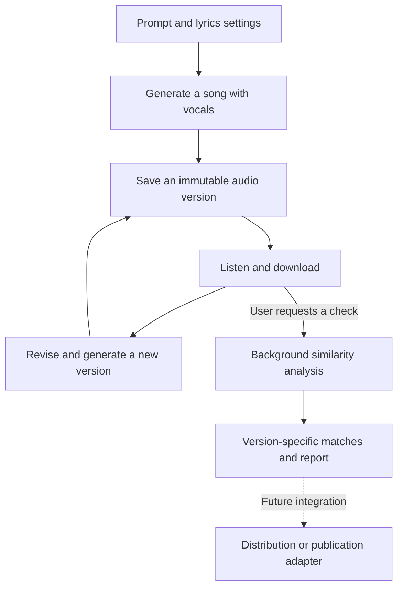
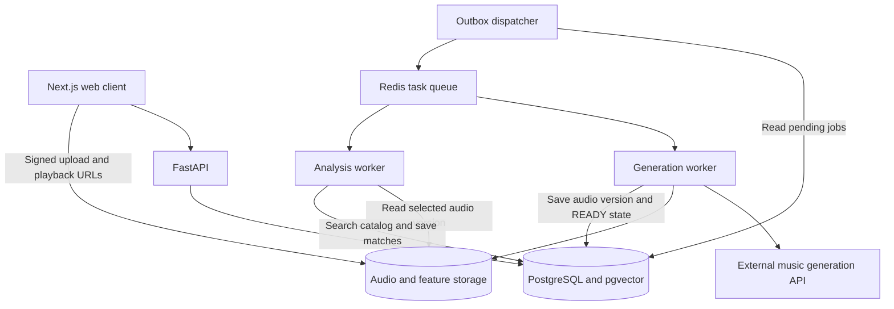

<callout icon="🎵" color="blue_bg">
An AI music platform designed to turn a text prompt into a song with vocals and lyrics, then let creators request audio-similarity analysis for any saved version without interrupting the creative process.
</callout>

# Overview

| | |
| --- | --- |
| Project type | Personal full-stack and AI systems project |
| Current stage | Local creation, versioning, chroma search, and an opt-in melody/duration experiment implemented; live vocal generation and real-music accuracy evaluation pending |
| Focus | AI API integration, asynchronous processing, audio retrieval, versioned data, reliability, and measurable performance |
| Current stack | Next.js, TypeScript, Python, FastAPI, SQLite, NumPy, librosa, soundfile, local file storage, separate generation and analysis workers; Docker configuration included |
| Generation provider | ElevenLabs adapter implemented; final provider selection, live access, vocal quality, and cost validation pending |
| Repository | [GitHub — automusic](https://github.com/pgh4131/automusic) |
| Design baseline | v0.3 · <date start="2026-11-02" /> |

# Problem

Music generation, revision, and similarity review are separate tasks. A creator needs to generate a song, listen to it, revise the lyrics or musical direction, and decide which version is worth checking against a reference catalog. Requiring a full analysis after every generation could interrupt that iteration, especially before analysis latency is understood.

AutoMusic brings these tasks into one workspace while keeping generation and analysis independently executable. The central product decision is to make a finished generation available for playback immediately after file validation, with a separate **Check similarity** action for the selected version.

# Intended Product Flow

1. Describe a song using a prompt and supported musical settings.
2. Generate lyrics automatically or supply original lyrics.
3. Generate a song with vocals and save the audio, lyrics, and generation settings.
4. Listen, download, or change the prompt and lyrics to create another version.
5. Request similarity analysis for the version the creator wants to review.
6. Compare candidate tracks and matching time ranges, with the report attached to that exact audio version.

For the MVP, revision means regenerating from changed lyrics or settings, or uploading an externally edited file. A waveform editor, stem mixing, and section-level regeneration are later extensions.

# Architecture Proposal

The current personal-use implementation runs Next.js, FastAPI, and separate database-polling generation and analysis workers with SQLite and local audio/feature storage. The diagram below is an expansion proposal, not the current deployment. A PostgreSQL Docker configuration is included; Redis/Celery, pgvector, and object storage remain optional later milestones.

# Engineering Decisions

## Independent Generation and Analysis

Generation ends when the saved audio is ready to play. Analysis starts only after the user requests it, and continues in the background. A creator can start V2 while V1 is being checked. If analysis fails, the service retries analysis against the existing audio rather than paying to generate the song again.

## Immutable Versions and Reproducible Results

Each generated or uploaded revision has its own audio asset ID. A report records that ID, the selected range, reference-catalog snapshot, feature version, and algorithm configuration. A completed V1 analysis cannot mark V2 as checked. Changes to a title or draft lyrics do not invalidate an audio-only analysis if the actual audio is unchanged.

The data model separates song groups, generation runs, audio versions, analysis runs, reference tracks and segments, matches, job attempts, and usage events.

## Two-Stage Similarity Search

The implemented baseline retrieves candidate tracks from precomputed pooled contrast-chroma features, then performs subsequence DTW to estimate matching ranges. The local reference catalog contains 74 FMA Small clips selected with an exact CC BY/CC0 allowlist. Learned embeddings and alternative retrieval methods remain later experiments.

Candidate recall and final match quality will be measured separately: a track missed during retrieval cannot be recovered by the later alignment stage. The initial scope is audio-similarity review within the indexed catalog; independent melody, rhythm, harmony, and lyric-text scoring are not assumed to be solved.

## Counterexample-Driven Melody Experiment

An accompaniment-dominant counterexample exposed a weakness in chroma retrieval. A separate opt-in experiment now extracts foreground pitch candidates and note durations, aligns pitch intervals, and reports melodic and duration distances separately. It scans every usable reference in the pinned snapshot, caches derived notes by source and method hashes, and records unsupported inputs or partial coverage explicitly. This signal-processing baseline is not a verified vocal separator.

A generator produces 256 original synthetic pairs with controlled melody, accompaniment, timbre, transposition, tempo, and duration changes. Thresholds use development compositions only; the packaged calibration is checked against the method's SHA-256. Previously inspected test compositions are labeled regression data, with a fresh composition-disjoint test retained for v2. The new test's 64 pairs had no melodic false positives or false negatives; the 32-pair low-register stress set still had two false positives and one false negative. Duration evaluation missed five positive low-register cases. These results describe a small synthetic task, not real-vocal or legal plagiarism accuracy. Multiple-window catalog-search false positives remain uncalibrated. [Full experiment and limitations](melody-review-experiment.md)

## Failure Recovery and Cost Control

The design uses database-backed job state and an outbox to recover from queue publication failures. Worker leases and conditional result commits protect against duplicated delivery and stale workers. Repeated requests can attach to an existing active analysis or reuse a valid completed result.

Generation requests have separate usage limits and provider-call records. If a paid request has an uncertain outcome, the service must reconcile it where the provider supports that, rather than blindly submitting another generation.

## Responsive Repeated Checks

Input features can be reused when audio and extraction settings are unchanged. Completed reports are reused only when the audio, range, reference snapshot, and analysis configuration match. Changed audio starts as an unchecked version. Incremental analysis of unchanged audio regions is a later optimization requiring verified content and boundary handling.

No end-to-end latency is claimed yet. The benchmark will separate queue wait, decoding, feature extraction, retrieval, alignment, and persistence, and distinguish a first analysis from a cached result.

# Current Work and Validation Plan

**Design completed:** product scope, user flows, architecture diagrams, data model, API boundaries, asynchronous job lifecycle, recovery policies, version semantics, and evaluation plan.

**First code milestone implemented:** the prompt and lyrics UI, official ElevenLabs API adapter, persistent generation requests, a separate worker, progress and error states, audio validation and storage, playback, downloads, and session history. A clearly labeled local instrumental demo exercises the flow without claiming AI vocals.

**Song versioning implemented:** versions are grouped under one song with V1/V2 numbering and a recorded source version. Creators can select a ready version, reload its prompt, lyrics, and settings, and generate a new version without overwriting earlier audio. Regenerating from V1 after V2 exists creates V3 with V1 recorded as its parent. Failed versions remain in history. Existing production rows and audio URLs are preserved through an additive table backfill.

**Verified locally:** 42 backend tests, TypeScript checking, the Next.js production build, and Docker Compose configuration syntax. Version tests cover audio/settings preservation, branching, concurrent numbering, duplicate requests, failed history, and legacy compatibility. Analysis tests cover manual execution, deduplication, version isolation, snapshot pinning, restart persistence, corrupted files, interruptions, and unsupported inputs. Browser verification covered generation demos, version switching, manual analysis submission, pending-to-complete status, the no-candidate result, reload persistence, and result reuse. The same clip-player component was verified separately with actual saved WAV and FMA MP3 files for start offsets, automatic stopping, and replay; this is not a claim of a complete positive-match UI test. Official generation-provider requests use HTTP mocks without paid calls.

**Measured retrieval experiment:** index 69 FMA clips and hold out 5 recordings. Original excerpts retrieved the source at rank 1 in 10/10 cases; +2-semitone and 1.15x-tempo transformations did so in 5/5 cases each. The five held-out recordings produced no candidates, and one white-noise query was rejected as unsupported. Warm query medians were approximately 25–28ms; the first original-excerpt query took about 569ms. A saved 60-second demo version completed processing against all 74 clips in about 913ms through the local API/DB flow. These are small development experiments on excerpts and controlled transformations, not compositional-similarity or plagiarism accuracy, browser latency, or production p95.

**Counterexample audit and follow-up:** a controlled, accompaniment-dominant synthesis test returned a candidate when the melody changed but accompaniment stayed the same, and missed the source when the melody stayed the same but accompaniment changed. This led to the separate melody/duration experiment and controlled evaluation above. Musical-similarity evidence remains separate from legal questions of protected expression and derivation.

**Experimental UI verified:** selecting the new mode submitted a job, progressed to completion, and displayed five candidates with separate distances and comparison players. The first 60-second demo check across 74 clips took 15.47 seconds of worker processing, including cold reference-note extraction. Both saved WAV and FMA MP3 segment players loaded, sought, and stopped correctly. Reload restored results, identical conditions reused the existing job, and the baseline result remained separate. The 390px layout had no horizontal overflow. These candidates lack compositional ground truth; UI success is not accuracy validation.

**Still pending:** live vocal generation, vocal/lyric quality, actual generation cost, and real-music accuracy evaluation with permitted rerecorded or cover pairs. Docker startup and PostgreSQL execution remain unverified. Authentication, multi-user isolation, and subscriptions are outside the current personal-use scope. Uploads, generation cost quotas, and a waveform editor are not implemented.

| Milestone | Deliverable and validation |
| --- | --- |
| Generation and retrieval experiments | Generate a real vocal song through an official API; establish an audio-search baseline on a permitted reference set |
| Backend foundation | Save immutable versions; support independent generation and analysis jobs, idempotency, and failure recovery |
| First-user MVP | Prompt and lyrics inputs, generation, version history, user-requested checks, playback, downloads, and reports |
| Measured improvements | Compare candidate recall, match quality, latency, resource use, and recovery behavior under fixed conditions |
| Publication extension | Add a destination-specific adapter and metadata requirements after the target is defined |

Quality evaluation will include known excerpts, controlled audio transformations, permitted rerecorded pairs where available, same-genre nonmatches, and inputs without a corresponding reference. Transformations of the same recording will not be presented as proof of general compositional-similarity detection.

Reliability validation covers repeated clicks, analysis interruption, version separation, and uncertain generation outcomes. Queue-publication failures apply to the future queue architecture. The current user is the owner; ongoing personal use and measured improvements are the next source of evidence. No external adoption figures are claimed.

# Scope and Future Direction

The long-term goal is a workflow from prompt-based creation through review to destination-specific registration or publication. The MVP includes both vocal-song generation and on-demand similarity checks. External registration, billing, large batch production, and automatic regeneration loops are later work.

Similarity results describe matches within the selected reference catalog and its available time ranges. They do not determine legal plagiarism or guarantee coverage of commercial music. Reference-audio processing and playback permissions will be recorded separately before a catalog is exposed to users.
