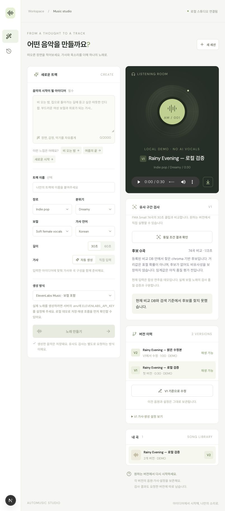

# 로컬 음악 유사 구간 검색 엔진

기록일: 2026-11-02. 개인용 SQLite·로컬 파일 구성으로 구현했다. 생성 제공자 선택과 무관하게 동작하며 유료 음악 생성 API를 호출하지 않는다.

후속 검토: 국내 판례와 연구 기준을 조사하고 직접 반례를 실행한 결과, 기존 chroma 엔진이 반주와 주선율을 충분히 구별하지 못함을 확인했다. 아래 검색 실험의 성공을 표절 검토 성능으로 해석하지 않는다. 이후 **선율·음 길이 실험 방식과 256쌍의 평가 집합**을 별도로 추가했다. 이 문서의 알고리즘·성능 표는 기존 chroma 방식에 대한 기록이다. [새 실험 결과](melody-review-experiment.md) · [판단 기준·반례·개선 조건](plagiarism-criteria-review.md)

## 현재 데이터

FMA Small의 8,000개 30초 클립 중 메타데이터의 라이선스 표기를 정확한 허용 목록과 대조해 74곡을 준비했다. 이번 목록은 CC0 1.0 Universal 54곡과 Attribution 3.0 International 20곡이다. 모호한 Attribution/Public Domain 표기, NC·ND·SA 표기와 다른 지역판 라이선스는 자동으로 추정하지 않고 제외했다. 전체 자료가 74곡이라는 뜻이 아니라 현재 보수적인 적재 정책의 결과다. [FMA 공식 데이터·라이선스 안내](https://github.com/mdeff/fma)

공식 `fma_metadata.zip`과 `fma_small.zip`의 ZIP 디렉터리·필요 항목만 HTTP Range로 받았다. 메타데이터 전송 약 25.6MB, 오디오와 ZIP 탐색 전송 약 85.0MB였다. 압축 해제한 CSV 등이 있어 로컬 `data/corpus/`는 약 334MiB다. 전체 ZIP의 SHA-1 검증을 수행한 것은 아니며, 개별 ZIP 항목 CRC와 내려받은 파일의 SHA-256을 사용했다. 적재 근거는 `data/corpus/import-report.json`과 `tracks.csv`에 남긴다.

SQLite `corpus_tracks`에는 제목·창작자·출처·라이선스·실제 클립 길이·특징 버전·파일 hash를 저장한다. 원본 MP3와 특징 NPZ는 별도 파일이다. 특징을 개선할 때 이전 revision을 지우지 않고 새 ID를 추가했다. 따라서 전체 테이블 행 수와 현재 검색 대상 곡 수는 다를 수 있다.

## 검색과 작업 흐름

1. 선택한 음원 버전에 대해서만 검사 요청을 접수한다. 생성 성공 시 검사 작업을 만들지 않는다.
2. 입력 hash, 비교곡 revision·파일 hash 목록, 알고리즘 버전을 접수 시 고정한다. 동일 조건의 대기·완료 작업은 재사용한다.
3. 분석 워커가 파일을 검증하고 디코딩한다. 6~180초·최대 PCM 크기를 제한하며 무음이나 잡음 중심 입력은 분석 불가로 반환한다.
4. 22,050Hz mono, FFT 4,096·hop 2,048의 chroma를 4fps로 합친다. 프레임별 공통 바닥 성분을 제거해 음색·광대역 성분의 영향을 줄인다. 원본 시간축을 보존한다.
5. 최대 10초 창·5초 이동, 창 내 4구간 pooling 특징으로 전체 등록 구간을 정확 탐색한다. 12개 pitch-class 이동을 비교하고 질의 창마다 최대 20곡을 선택한다.
6. 후보 곡별 12개 이동에 대해 subsequence DTW로 정렬한다. 경로 기울기를 제한하고 양쪽 시작·종료 시각과 거리 기준을 확인한다. 곡당 가장 가까운 1구간, 상위 최대 5곡을 제공한다.
7. 결과를 요청한 production ID의 `analysis_runs`에 보관한다. 비교 DB·알고리즘이 바뀌면 새 조건으로 검사할 수 있다. 중단된 검사는 실패로 남고 사용자가 다시 요청한다. 음악을 재생성하지 않는다.

현재 특징 버전은 `contrast-chroma-22050-2048-4fps-v2`, 알고리즘은 `pooled-contrast-dtw-v3`다. 정렬 거리 임계값 0.18과 spectral-flatness 0.35 제한은 초기 실험 설정이며 광범위하게 보정한 제품 기준이 아니다. [librosa 특징 추출](https://librosa.org/doc/0.11.0/feature.html), [subsequence DTW](https://librosa.org/doc/0.11.0/generated/librosa.sequence.dtw.html)

## 실제 FMA 통제 실험

74곡 중 마지막 5곡을 색인에서 완전히 제외하고 69곡을 검색 대상으로 삼았다. 앞의 10곡에서 클립 기준 7.25~17.25초를 질의로 만들었다. 이 중 5곡은 +2반음 및 1.15배 템포 변형도 시험했다. 데이터 순서와 random seed는 스크립트에 고정했다. 임계값 조정 후 확인한 소규모 개발 실험이며 독립적인 최종 테스트 세트가 아니다.

| 입력 | 사례 수 | 결과 | 디코딩·특징 추출·검색 중앙값 |
| --- | --- | --- | --- |
| 원본 발췌 | 10 | 원곡 1위 10/10 | 27.67ms |
| +2반음 변형 | 5 | 원곡 1위 5/5 | 28.11ms |
| 1.15배 템포 | 5 | 원곡 1위 5/5 | 25.40ms |
| 색인에서 제외한 곡 | 5 | 후보를 찾은 질의 0/5 | 27.39ms |
| 백색잡음 | 1 | 분석 불가 처리 1/1 | 2.87ms |

원본 발췌의 첫 요청은 약 569ms였다. 위 중앙값을 초기 컴파일 비용이나 운영 환경의 p95로 해석하지 않는다. 코퍼스 로딩·큐 대기·브라우저 네트워크는 이 표의 질의 시간에 포함하지 않았다. [사례별 원시 측정](similarity-benchmark.json)

별도로 실제 저장된 60초 합성 데모 버전을 전체 74곡 DB에 검사해 약 913ms에 결과를 저장하고 같은 조건의 재요청이 기존 결과를 반환하는 것을 확인했다. 이는 데모를 이용한 API·DB 처리 검증이며 실제 보컬 생성이나 사용자 체감 지연의 측정은 아니다.

## 검증과 한계

백엔드 테스트 42개와 TypeScript 검사·Next.js production build를 통과했다. 실제 저장 DB에서도 수동 요청→결과 저장→재사용을 확인했다. 이후 서버 실행 승인을 받아 브라우저에서 V1 검사 접수·대기·완료·후보 없음 표시, 새로고침 후 결과 복원과 재사용을 확인했다. V1의 워커 처리 시간은 약 1.13초로 표시됐으며 V2의 결과도 보존됐다. 브라우저 경고·오류 로그는 없었다.

구간 재생은 동일 컴포넌트를 임시 검증 화면에 배치해 실제 저장 WAV와 FMA MP3로 확인했다. WAV는 7초에서 시작해 약 10.12초, MP3는 5초에서 시작해 약 8.14초에 자동 정지했다. 재재생 시 시작으로 돌아갔고 readyState=4·error=null이었다. 임시 화면은 검증 후 제거했다. 실제 후보가 나온 전체 결과 화면 및 모바일 화면 검증과는 구분한다.



- FMA 클립 밖의 원곡 구간이나 DB에 없는 상업곡은 검사하지 않는다. 후보가 없다는 결과는 전체 음악과 비슷하지 않다는 뜻이 아니다.
- 동일 녹음의 발췌·통제 변형 검색과 새 작곡·재연주·커버 사이의 유사성은 다르다. 후자는 아직 평가하지 않았다.
- chroma는 주로 pitch-class 특성을 나타낸다. 독립적인 멜로디·리듬·화성·가사 표절 점수는 제공하지 않는다.
- 현재는 곡당 가장 가까운 한 구간만 표시한다. 작은 후보 집합에서 놓친 곡은 정렬에서 복구되지 않는다. 큰 DB의 후보 재현율·성능은 별도 측정해야 한다.
- 타악·잡음 중심의 음악과 발음·가사 비교는 이 기준 엔진의 범위가 제한된다.
- API 키·실제 생성 호출·결제는 사용하지 않았다.

## 재현 명령

저장소 루트에서 실행한다.

```bash
PYTHONPATH=services/backend .venv/bin/python -m app.fma --limit 100
PYTHONPATH=services/backend .venv/bin/python -m app.fma --reindex
PYTHONPATH=services/backend .venv/bin/python -m app.benchmark_similarity
.venv/bin/python -m pytest -q
npm run typecheck
npm run build
npm run dev
```

웹에서 재생 가능한 버전을 선택한 뒤 `유사 구간 검사`를 누른다. `npm run dev`는 API·생성 워커·분석 워커·웹을 함께 실행하며 Ctrl+C로 종료한다. Docker에서도 분석 워커 정의를 추가했지만 이번 변경의 Docker 실기동은 검증하지 않았다.
